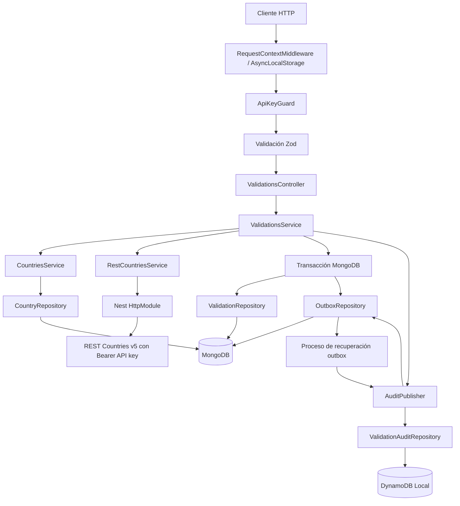

# 02 Arquitectura y decisiones técnicas

**Proyecto:** `external-validation-service-auco`  
**Estado:** Etapas 1 a 5 integradas (base HTTP, persistencia, catálogo, enriquecimiento, validaciones con outbox y publicación/recuperación de auditoría DynamoDB); Etapa 6 (verificación y documentación final) ejecutada sin cambios de arquitectura; D-04, D-09 (revisada por D-21), D-10, D-11 y D-14–D-25 aprobadas  
**Referencias:** [`01-requirements.md`](./01-requirements.md), [`03-development-plan.md`](./03-development-plan.md)

## 1. Objetivos y principios

Entregar los dos endpoints exigidos por Auco y una auditoría robusta y demostrable. Priorizar mantenibilidad significativa sobre scaffolding empresarial. Separar con claridad los requisitos de la prueba de las mejoras propias: API key, país explícito, outbox, idempotencia y Swagger.

**Los ejemplos de código previamente compartidos por la persona desarrolladora son ideas de diseño, no código para copiar literalmente.**

**Regla innegociable:** no implementar verificación real de identidad; enriquecer datos geográficos nunca equivale a verificar una identidad.

## 2. Tecnologías y entorno local

| Área | Decisión | Justificación |
| --- | --- | --- |
| Runtime | Node.js 24 | Runtime e imagen Docker elegidos. |
| Framework | NestJS 12 con adaptador Express | DI, módulos, guards, interceptors y pruebas HTTP. |
| Lenguaje | TypeScript 6, `strict: true`, ESM nativo | Tipado sólido y base moderna. |
| Validación | Zod y Standard Schema de NestJS | Validación runtime para entradas y entorno. |
| Pruebas | Vitest, `@nestjs/testing`, Supertest | Unitarias, integración y e2e. |
| MongoDB | Driver oficial `mongodb`, una base de datos y replica set | API nativa y outbox transaccional. |
| DynamoDB | `@aws-sdk/client-dynamodb`, `@aws-sdk/lib-dynamodb` | SDK AWS v3 y Document Client. |
| HTTP externo | `@nestjs/axios` / `HttpModule` en `EnrichmentModule` (Etapa 3) | Cliente específico de REST Countries v5 con bearer token, timeout y validación Zod. |
| Documentación | `@nestjs/swagger` | OpenAPI y Swagger UI. |
| Contenedores | Docker Compose: MongoDB replica set, DynamoDB Local | Desarrollo/evaluación reproducibles. |
| Calidad | ESLint, Prettier y typecheck | Reglas verificables automáticamente. |

**Puertos locales definidos:** MongoDB `127.0.0.1:27018` → `27017` del contenedor; DynamoDB Local `127.0.0.1:8001` → `8000`. Si NestJS corre dentro de Docker Compose, usar nombres de servicio accesibles y configurar correctamente el host anunciado por el replica set; `localhost` del contenedor no apunta al host Windows.

## 3. Arquitectura lógica



El GET consulta exclusivamente `ValidationRepository`; no llama REST Countries ni DynamoDB.

### 3.1 Responsabilidades

- **Validación de entrada:** esquemas Zod para body, params, headers y entorno; nunca afirmar autenticidad documental.
- **CountriesModule:** catálogo local de países permitidos, índice único, seed idempotente y validación del país solicitado.
- **EnrichmentModule:** integración HTTP REST Countries, validación Zod de respuesta y mapeo a una fotografía geográfica pequeña. No recibe nombre ni documento.
- **ValidationsModule:** orquesta casos de uso, mapeos y contratos HTTP. Consulta primero la idempotencia HTTP cuando la clave está presente, antes de consumir REST Countries.
- **AuditModule:** identidad estable del evento, escritura condicional DynamoDB, actualización de estado y recuperación de pendientes.
- **MongoModule / DynamoModule (D-17):** infraestructura independiente, sin módulo agregador `DatabaseModule`. `MongoService` posee el `MongoClient` (conexión en `onModuleInit`, cierre en `onApplicationShutdown`, `withTransaction()`); `DynamoService` posee `DynamoDBClient` y `DynamoDBDocumentClient` (lazy, `destroy()` al cerrar). No son globales ni los importa `AppModule`: cada módulo de dominio importa solo el que necesita (Etapas 3–5).
- **CommonModule (`@Global`)**: único módulo global; contexto ALS, configuración tipada, excepciones, guard, interceptores y herramientas comunes. `HttpModule` se importa solo en `EnrichmentModule` durante la Etapa 3. Nunca globalizar los módulos de dominio.

## 4. Estructura de carpetas (crear solo las necesarias)

```text
src/
├── main.ts
├── app.module.ts
├── app.setup.ts
├── swagger-conf.ts
├── config/
│   ├── env.schema.ts
│   └── configuration.ts
├── common/
│   ├── common.module.ts
│   ├── decorators/
│   ├── filters/
│   ├── guards/
│   ├── interceptors/
│   ├── middlewares/
│   │   └── request-context.middleware.ts
│   ├── services/
│   │   └── request-context.service.ts
│   ├── interfaces/
│   ├── constants/
│   └── utils/
├── database/
│   ├── mongo/
│   │   ├── mongo.module.ts
│   │   ├── mongo.service.ts
│   │   ├── mongo.repository.ts
│   │   ├── mongo-config.ts
│   │   └── mongo-errors.ts
│   ├── dynamo/
│   │   ├── dynamo.module.ts
│   │   ├── dynamo.service.ts
│   │   ├── dynamo.repository.ts
│   │   ├── dynamo-config.ts
│   │   ├── dynamo-errors.ts
│   │   └── dynamo-table.ts
│   └── init/                      # inicialización explícita e idempotente (D-20)
│       ├── infrastructure-guards.ts
│       ├── initialize-mongo.ts
│       └── init-infrastructure.ts
├── validations/
│   ├── validations.module.ts
│   ├── controllers/
│   ├── services/
│   ├── repositories/
│   ├── entities/
│   ├── interfaces/
│   ├── schemas/
│   ├── messages/
│   └── swagger/
├── countries/
│   ├── countries.module.ts
│   ├── services/
│   ├── repositories/
│   ├── entities/
│   ├── interfaces/
│   ├── schemas/
│   └── seeds/
├── enrichment/
│   ├── enrichment.module.ts
│   ├── services/
│   ├── interfaces/
│   └── schemas/
└── audit/
    ├── audit.module.ts
    ├── services/
    ├── repositories/
    └── interfaces/
```

Incorporar `OutboxRepository`, `AuditPublisher` y recuperación en las carpetas que correspondan. Builders y validadores de dominio solo cuando exista complejidad que lo justifique. No crear carpetas vacías por costumbre. `swagger/` contiene metadata/constantes, no modelos DTO duplicados.

## 5. Procesamiento de solicitudes y diseño HTTP

1. **`RequestContextMiddleware`:** generar UUID `requestId`, registrar `requestUrl` y `startedAt`, devolver `x-request-id` e inicializar AsyncLocalStorage mediante `RequestContextService`. `countryCode` se captura en mayúsculas únicamente si el header cumple `^[A-Za-z]{2}$`; en otro caso queda `undefined`. Este dato ALS sirve solo para correlación; la lógica de negocio utiliza el valor validado por Zod y el catálogo `countries`. El middleware se ejecuta antes de guards/pipes/controller. `@CurrentContext()` permite acceso controlado desde controllers.
2. **Guard global:** exigir `x-api-key`, salvo rutas explícitamente `@Public()` como health. Comparar con secreto validado; nunca registrar la llave.
3. **Zod:** validar body, parámetros y país. `x-country-code` obligatorio solo en POST; GET no requiere este header (D-04 aprobada).
4. **Controller delgado:** delega al servicio. GET lee Mongo; POST enriquece, persiste y audita.
5. **`ResponseInterceptor`:** envuelve respuestas **exitosas** como `{ data }` sin transformar campos (el mapeo `_id` → `id` lo hace el mapper de `validations`, D-16), sin considerar `null`, `false`, `0` ni arrays vacíos como fallos automáticos. Contrato pequeño y probado.
6. **`TimeOutInterceptor`:** convierte `TimeoutError` RxJS a `GatewayTimeoutException`, propagando los demás errores. Configurar además timeouts por dependencia; un timeout RxJS no garantiza abortar operaciones Mongo/Dynamo.
7. **`AllExceptionFilter`:** solo maneja **errores**, conserva códigos relevantes y devuelve `{ statusCode, error, message, path, timestamp, requestId }` sin PII, stacks ni credenciales.

Ejemplo ilustrativo:

```ts
catchError((error: unknown) => {
  if (error instanceof TimeoutError) {
    return throwError(() => new GatewayTimeoutException('Request timeout'));
  }
  return throwError(() => error);
});
```

### 5.1 Rutas y respuestas

- `POST /validations`: `201` e `id` creado **después del commit MongoDB de validación + outbox**, sin esperar confirmación de DynamoDB como condición de éxito. Publicación inmediata de mejor esfuerzo y recuperación eventual. `Idempotency-Key` opcional; replay de misma operación devuelve el mismo `id` con `201`, sin nueva creación.
- `GET /validations/:id`: `200` y registro; `400` ID malformado, `404` inexistente.
- `GET /health`: `200` con `{ "data": { "status": "ok" } }`, público, sin detalles internos.
- Swagger UI: `SWAGGER_ENABLED`; `addApiKey` + `@ApiSecurity('api-key')`; no imponer prefijos/versionado adicionales. Proteger o deshabilitar Swagger en producción.

### 5.2 Metadata y Swagger

- Constantes generales en `src/swagger-conf.ts` (título, descripción, versión y esquema de seguridad).
- Constantes específicas `SWCONF_VALIDATIONS` en `validations/swagger/`, usadas desde `@ApiOperation(...)`, decoradores de respuesta y `@ApiSecurity('api-key')` a nivel de controller.
- Aprovechar Zod/Standard Schema para generar OpenAPI cuando sea compatible con las versiones instaladas. No duplicar modelos enteros con decoradores salvo necesidad técnica.

## 6. Configuración e inyección de dependencias

- `env.schema.ts`: helpers `requiredString`, enteros positivos con default, booleanos estrictos (`'true' | 'false'`) y `validateEnv` con errores legibles sin revelar secretos.
- `configuration.ts`: configuración central tipada, integrada con `ConfigModule.forRoot(CONFIG_MODULE_OPTIONS)` con `isGlobal: false` y `validate: validateEnv`, importado en `CommonModule`; `APP_CONFIG` expone `IAppConfig` tipado. No depender de efectos laterales de importación.
- Configurar puerto/entorno, Swagger, URI/DB Mongo, endpoint/tabla/región/credenciales locales Dynamo, API key, URL REST Countries, timeouts y, si aplica, intervalo/backoff de outbox.
- **Variables de persistencia (D-19):** `MONGO_URI`, `MONGO_DB_NAME` (default `external_validation`), `MONGO_TIMEOUT_MS` (default 5000: `serverSelectionTimeoutMS` y `connectTimeoutMS`, no corta transacciones en curso), `DYNAMODB_ENDPOINT`, `DYNAMODB_TABLE` (default `validation_audit`), `DYNAMODB_TIMEOUT_MS` (default 2000, por intento de conexión/solicitud; el SDK hace como máximo 2 intentos), `AWS_REGION`, `AWS_ACCESS_KEY_ID`, `AWS_SECRET_ACCESS_KEY`. El schema base las deja **opcionales** para que HTTP no dependa de ninguna base; `MongoService` exige `MONGO_URI` y `DynamoService` exige endpoint (fuera de producción) y credenciales explícitas cuando hay endpoint, con error legible al instanciar el módulo. No hay timeout compartido `DB_TIMEOUT_MS`; el presupuesto fino de la publicación inline (D-10) se cierra en la Etapa 5.
- **Guard AWS local:** fuera de producción `DYNAMODB_ENDPOINT` es obligatorio, de modo que omitirlo nunca dirige escrituras a una cuenta real. El script de inicialización y las pruebas de integración exigen además que el endpoint sea `localhost`, `127.0.0.1` o `[::1]`, sin opción de omitir la comprobación.
- `.env` jamás se commitea. `.env.example` contiene placeholders y credenciales ficticias AWS Local. Nunca loguear el objeto de configuración completo.
- `main.ts` solo inicializa; `configureApp(app)` en `app.setup.ts` reutilizado tanto en ejecución como en tests e2e.

## 7. Diseño MongoDB

### 7.1 Colecciones

**`countries`**

```ts
interface ICountry {
  code: string; // ISO alfa-2 en mayúsculas
  name: string;
  enabled: boolean;
  createdAt: Date;
  updatedAt: Date;
}
```

Índice único `{ code: 1 }`; seed `CO`, `MX` con `$setOnInsert` y `upsert: true`, sin sobrescribir datos anteriores. No inferir países de operación de Auco sin confirmación.

**`validations`** (esquema cerrado en la Etapa 4; `_id` se genera antes de la transacción):

```ts
interface IValidation {
  name: string;
  documentNumber: string;
  countryCode: string;
  enrichment: ICountryEnrichment;
  createdAt: Date;
  idempotencyKey?: string;
  requestFingerprint?: string;
}
```

`_id` de MongoDB es interno; la API expone `id`. Los metadatos de idempotencia viven en la validación y no aparecen en la respuesta pública (mapper de lista blanca). Índice `idempotencyKey_unique`: único y **parcial** (`partialFilterExpression: { idempotencyKey: { $type: 'string' } }`). Sin clave, no hay deduplicación HTTP. `requestFingerprint` es `v1:` + HMAC-SHA256 (§10.3); no se guarda el body ni se usa una colección adicional.

**`audit_outbox`**

```ts
interface IOutboxEvent {
  eventId: string; // UUID generado una sola vez, antes de la transacción
  validationId: ObjectId; // referencia a validations._id
  eventType: 'VALIDATION_CREATED';
  documentNumber: string; // sensible: proteger en logs
  countryCode: string;
  occurredAt: Date; // igual a validations.createdAt
  status: 'PENDING' | 'PUBLISHED' | 'FAILED';
  attempts: number; // 0 al crear; cada claim lo incrementa
  nextAttemptAt: Date; // = occurredAt al crear; hace de lease al reclamar y de backoff al reintentar
  publishedAt?: Date;
  claimToken?: string; // dueño del claim vigente (fencing)
  lastAttemptAt?: Date;
  lastErrorCode?: string; // solo nombre/código, nunca mensajes
  lastErrorAt?: Date;
  failedAt?: Date;
  // El ítem DynamoDB se reconstruye de forma determinista con estos campos.
}
```

Índices de `audit_outbox`: `eventId_unique` (único) y `status_nextAttemptAt` (`{ status: 1, nextAttemptAt: 1 }`), ambos creados con `infra:init`; la Etapa 5 **no añade índices**: el claim usa el mismo. Estados: `PENDING` (puede tener un lease vigente), `PUBLISHED` (terminal, hay evidencia de persistencia en DynamoDB) y `FAILED` (terminal, error permanente; se conserva y no se reintenta solo). No existe estado `CLAIMED` ni campo `leaseExpiresAt`: el lease es `nextAttemptAt` (ver §10.4).

### 7.2 Repositorio MongoDB mínimo

`abstract class MongoRepository<T extends Document>` tendrá `MongoClient`, nombres de base/colección, `Collection<T>` tipada y solo operaciones compartidas necesarias (`create`, `findById`, `findOne` y soporte transaccional, según uso real). Los repositorios concretos implementan búsquedas/actualizaciones de dominio. Soportar `ClientSession` donde intervenga una transacción. Conservar errores por índice único hasta mapearlos correctamente en la capa de aplicación.

**Contrato implementado (Etapa 2):** `MongoRepository<T>` expone `create`, `findById`, `findOne` (todos aceptan `ClientSession` opcional) y `ensureIndexes()`; los índices los declara cada repositorio concreto en `indexes` y su creación es un procedimiento explícito e idempotente (D-20), no solo `onModuleInit`. `MongoService.withTransaction()` usa `readConcern`/`writeConcern` `majority` y relanza el error original. `isDuplicateKeyError()` identifica `E11000` sin alterarlo. `DynamoRepository<T>` expone `putIfNotExists` (`attribute_not_exists(PK)`, sin `put` incondicional), `getByKey` (lectura consistente) y `queryByPartition` (orden ascendente por `SK`, solo `limit`); `isConditionalCheckFailed()` identifica el rechazo condicional. Ninguno captura ni envuelve errores del driver.

**Prohibido en el repositorio base:** `process.exit()`, `setTimeout()`, soft delete, paginación, métodos innecesarios y conversión indiscriminada de excepciones a `500`.

### 7.3 Límite transaccional

Iniciar una sesión MongoDB; insertar validación y evento pendiente en **una sola transacción**. Si falla cualquiera de las operaciones, hacer rollback de ambas. Crear índices y semillas fuera de la transacción del caso de uso. Manejar fallos transitorios sin repetir ciegamente operaciones no idempotentes.

## 8. Enriquecimiento REST Countries

- API externa de lectura y acceso mediante API key; país elegido explícitamente por header, no derivado del documento.
- Validar primero `countries`; solo transmitir el `code` a REST Countries.
- Aislar `RestCountriesService` del controller. `RestCountriesService` utiliza directamente el `HttpService` de NestJS desde `EnrichmentModule`, con timeout explícito y contrato REST Countries v5; no se crea `HttpRequestService` genérico.
- Validar con Zod; transformar únicamente campos útiles, aceptar opcionales ausentes y no guardar todo el payload remoto. Registrar `source: 'rest-countries'` y `enrichedAt` cuando aporte trazabilidad.
- Distinguir timeout (`504`), límite de tasa (`503`), y respuesta HTTP no 2xx, resultado vacío/país distinto, datos malformados y red (`502`). Sin reintentos automáticos. Un código sin coincidencia responde `200` con `data.objects` vacío.
- No hacer verificación de identidad ni inferir nacionalidad. Jamás enviar identificadores personales a REST Countries.

## 9. DynamoDB y auditoría

### 9.1 Clientes y jerarquía

```text
DynamoDBClient
  └── DynamoDBDocumentClient
       └── DynamoRepository<T>
            └── ValidationAuditRepository
```

La clase base maneja cliente, tabla y comandos compartidos estrictamente necesarios. `ValidationAuditRepository` construye `PK`/`SK`, payload y escritura condicional. **Nunca** fusionar las clases base MongoDB y DynamoDB.

### 9.2 Llaves y evento

```text
PK = DOCUMENT#<countryCode>#<documentNumber>
SK = <ISO_UTC_TIMESTAMP>#<stableEventId>
```

Atributos adicionales (`IValidationAuditItem`): `eventId`, `validationId`, `eventType`, `countryCode`, `createdAt` (ISO) y `schemaVersion`; el número de documento **no** se duplica como atributo. La partición agrupa los eventos de un documento **de un país**; la sort key (ISO UTC de ancho fijo + `eventId`) los ordena cronológicamente y desempata el mismo milisegundo. El ítem se reconstruye en cada intento desde el outbox (`ValidationAuditRepository.buildItem`), de modo que fecha, ID, claves y payload son idénticos en todos los reintentos. Las claves se construyen en una sola función (`buildAuditKeys`).

**D-09 revisada (D-21):** se compararon (A) `DOCUMENT#<doc>`, (B) `DOCUMENT#<CC>#<doc>` y (C) PK derivada por HMAC de país + documento. Se aprobó B: evita mezclar historiales del mismo número en países distintos, no añade secretos, sigue siendo una llave por documento y fecha y no tuvo costo de migración porque la Etapa 4 no había escrito ítems en DynamoDB. C queda como mejora futura de producción: protege el número en la clave, pero exige un secreto adicional y su rotación cambia las PK (ítems inmutables), por lo que requeriría verificación dual o reescritura.

Usar `ConditionExpression` de `PutItem` para prevenir colisiones en la llave completa (por ejemplo `attribute_not_exists(PK)`). Si ocurre falla condicional, comprobar `eventId`/identidad del registro existente antes de considerarlo replay exitoso; no ocultar conflictos verdaderos.

**Privacidad:** números de documento en llaves pueden ser sensibles. Aunque la prueba exige llaves por documento/fecha, en producción evaluar llave derivada con HMAC y autorización adecuada.

## 10. Consistencia, recuperación e idempotencia

### 10.1 Secuencia del POST y fallos parciales

```text
POST /validations
  -> Si existe Idempotency-Key: consultar replay/conflicto ANTES del proveedor
  -> Validar país y enriquecer mediante REST Countries
  -> Transacción MongoDB: insertar validación + evento outbox PENDING
      -> rollback/fallo de commit: NO responder 201
      -> commit confirmado: validación creada; 201 permitido
  -> Intentar publicar evento en DynamoDB de mejor esfuerzo, con timeout acotado
      -> éxito confirmado: marcar outbox PUBLISHED
      -> fallo o confirmación ambigua: conservar PENDING
  -> Responder 201 con el ID persistido

Worker local independiente, al arrancar y periódicamente:
  -> Consultar PENDING cuyo nextAttemptAt <= ahora
  -> PutItem condicional con PK/SK/eventId originales
  -> Confirmar PUBLISHED o programar siguiente reintento
```

El envío a DynamoDB y la actualización del estado MongoDB **no forman una única transacción distribuida**. Ante un fallo luego de guardar el evento DynamoDB pero antes de marcarlo `PUBLISHED`, el replay debe reconocer el mismo `eventId` y completar la conciliación sin duplicar eventos lógicos. El worker debe retomar eventos después de reiniciar la aplicación y al restablecerse DynamoDB. Su procesamiento puede invocarse desde tests para evitar pruebas dependientes de timers reales.

### 10.2 D-10 Política HTTP aprobada: `201` y auditoría eventual

- **Punto de confirmación HTTP:** commit exitoso de la validación **y** de su evento outbox en MongoDB.
- **DynamoDB disponible:** intentar publicar antes de responder si cabe dentro del presupuesto de timeout; marcar `PUBLISHED` cuando haya confirmación.
- **DynamoDB no disponible:** responder igualmente `201 Created` por la creación ya confirmada; persistir `PENDING` y reintentar automáticamente.
- **MongoDB falla antes del commit:** no crear respuesta de éxito; preservar error coherente con el fallo.
- **Garantía:** evento duradero pendiente con entrega eventual *at-least-once* y efecto idempotente por evento, siempre que el proceso de recuperación pueda ejecutarse y DynamoDB vuelva a estar disponible. No prometer que `201` implica lectura inmediata del evento en DynamoDB.
- **Presupuesto temporal:** la publicación de mejor esfuerzo no debe forzar `504` tras commit; definir timeouts por dependencia y, si no queda tiempo, dejar la publicación para el worker.

La alternativa rechazada `503` tras un fallo de DynamoDB informaba fracaso aunque el recurso ya existiera y, sin clave de idempotencia obligatoria, incentivaba POST duplicados. `202` tampoco describe tan bien el recurso ya creado. **Auco no impuso esta política**: es una decisión técnica propia que debe explicarse en el README.

### 10.3 D-11 `Idempotency-Key` opcional y concurrencia

- **Si el cliente lo envía:** calcular una huella (HMAC-SHA256 con `IDEMPOTENCY_HASH_SECRET`, ver más abajo) del body normalizado + país; mismo valor de clave + misma huella → mismo registro, mismo ID y respuesta `201`; reutilizar clave con huella diferente → `409 Conflict`.
- **Si no lo envía:** cada POST es una creación nueva; no prometer deduplicación por nombre/documento o requestId.
- Verificar la clave antes de llamar REST Countries; conservar un índice único **parcial** como árbitro frente a solicitudes concurrentes. Manejar conflictos de clave y reintentos transaccionales (`WriteConflict`, `E11000`) sin generar eventos adicionales. Crear `validationId`, `eventId`, timestamp y payload del evento estables fuera del callback transaccional.
- `requestId` identifica la solicitud para correlación, **no** el intento lógico de creación.
- La idempotencia de auditoría es **siempre necesaria**, con `eventId`/`PK`/`SK` inmutables y `ConditionExpression`. Una colisión condicional solo es replay exitoso tras comprobar que corresponde al evento original.
- No reutilizar el valor de `Idempotency-Key` para la clave de auditoría ni almacenar el body completo como huella.

**Implementación de la Etapa 4**

- **Fingerprint:** `"v1:" + HMAC-SHA256(IDEMPOTENCY_HASH_SECRET, JSON canónico { v, countryCode (mayúsculas), name (trim, NFC), documentNumber (trim) })`. Excluye la `Idempotency-Key`, el `requestId` y los headers de transporte. `IDEMPOTENCY_HASH_SECRET` (mín. 32 caracteres) es independiente de `API_KEY`, no tiene valor por defecto, no se genera en el arranque, es obligatoria al instanciar `ValidationsModule` y nunca se registra ni se devuelve.
- **Rotación:** no soportada todavía. Cambiar el secreto invalida los fingerprints guardados: un replay legítimo respondería `409`. Preservar los replays exigirá una estrategia futura (por ejemplo verificación dual con un secreto anterior, apoyada en el prefijo de versión); queda como decisión diferida.
- **Flujo:** consulta de replay antes del país y de REST Countries; `assertEnabled`; `enrich` **una sola vez**; `validationId`, `eventId` y `now` generados una vez; transacción corta con las dos inserciones y la misma `ClientSession`, sin HTTP.
- **Persistencia acotada** (solo con clave): hasta 3 intentos (`MAX_PERSISTENCE_ATTEMPTS`) con los mismos documentos y sin repetir llamadas al proveedor. Solo se interpretan: `E11000` del índice `idempotencyKey_unique`, errores transitorios (`TransientTransactionError`/`WriteConflict`) que sobreviven a los reintentos internos del driver y `UnknownTransactionCommitResult` (se busca el propio `validationId` antes de reintentar). Cualquier otro error, incluido `E11000` de otro índice, se relanza sin cambios. Tras una colisión o un error transitorio se lee al ganador hasta 3 veces (esperas de 25 y 50 ms): misma huella → replay `201` con el mismo `id`; huella distinta → `409`; ganador no visible o intentos agotados → `503` («Unable to confirm the operation; retry with the same Idempotency-Key»). Repetir con la misma clave es seguro porque el índice único evita duplicados.
- **Límite temporal de MongoDB (driver 7.9.0):** `timeoutMS` de `withTransaction()` está deprecado y **no tiene efecto**; el driver solo aplica un plazo fijo de 120 s entre intentos, sin interrumpir operaciones en curso. Lo único soportado es `maxCommitTimeMS`, que `MongoService` fija con el valor de `MONGO_TIMEOUT_MS`: acota el `commitTransaction` en el servidor. Al expirar (código 50) el driver **no** reintenta y propaga el error con la etiqueta `UnknownTransactionCommitResult`. Esto **no implica rollback**: en una prueba con un límite de 1 ms, parte de las transacciones con commit expirado quedaron persistidas y otras no.
- **Commit incierto:** con o sin `Idempotency-Key`, el servicio busca el registro por su propio `validationId`; si existe, responde `201` con ese `id`. Si no, con clave se reintenta de forma acotada y sin clave responde `503` («Unable to confirm the operation»); sin clave, repetir el POST podría crear otra validación.
- **Presupuesto global:** el resto de la transacción no tiene límite propio, y el timeout RxJS (`REQUEST_TIMEOUT_MS`, 15 s) no cancela operaciones en curso. Por tanto no se garantiza que un `504` implique que no habrá un commit posterior; la idempotencia con clave es lo que hace seguro el reintento. No se implementó cancelación manual.

### 10.4 Publicación, recuperación y presupuesto de tiempo (Etapa 5, D-21 a D-25)

**Componentes (`AuditModule`, no global):** `ValidationAuditRepository` (claves, ítem, comparación de identidad), `AuditPublisher` (`publishInline`, `processPendingBatch`, `publishClaimed`) y `AuditRecoveryWorker` (solo temporización). Sin dependencias nuevas: `setInterval` nativo.

**Claim/lease (D-22):** reclamar es una única actualización atómica de un documento: `findOneAndUpdate({ status: 'PENDING', nextAttemptAt: { $lte: now } }, { $set: { nextAttemptAt: now + AUDIT_LEASE_MS, claimToken, lastAttemptAt }, $inc: { attempts: 1 } }, { sort: { nextAttemptAt: 1 } })`. El lease **es** `nextAttemptAt`; un worker caído deja el evento elegible otra vez al vencer. Se reclama de uno en uno dentro del lote para que el lease no caduque esperando turno. Se justifica apartarse de «sin leases en instancia única» porque la publicación inline y el worker compiten por el mismo evento incluso con una sola instancia.

**Fencing y evidencia:** `markRetry`/`markFailed` filtran por `{ eventId, status: 'PENDING', claimToken }`: un intento antiguo (worker con lease vencido u operación inline que excedió su presupuesto) no modifica el estado de un claim nuevo. `markPublished(eventId, validationId)` solo se invoca con evidencia del evento correcto —`PutItem` condicional confirmado o `getByKey` consistente cuyo ítem tiene la identidad completa idéntica (`eventId`, `validationId`, `eventType`, `countryCode`, `createdAt`, `schemaVersion`)— y filtra por la identidad del evento, no por el token. Un timeout, un abort, una colisión con otro evento o un ítem ilegible jamás llegan a `PUBLISHED`.

**Reconciliación:** `ConditionalCheckFailedException` nunca se asume como éxito: se lee el ítem existente; misma identidad ⇒ replay válido; identidad distinta ⇒ colisión real (`FAILED`, `AUDIT_KEY_COLLISION`, el ítem existente no se sobrescribe); ítem ilegible ⇒ reintento. Si DynamoDB guardó el ítem pero falló el acuse o la actualización del outbox, el evento sigue `PENDING`; al reprocesarse choca con su propio ítem, se verifica y se marca `PUBLISHED` sin duplicar.

**Errores y backoff (D-23):** permanentes (`FAILED`): únicamente una colisión real de identidad y un outbox imposible de transformar en ítem. Todo lo demás (timeouts, red, 5xx, throttling, tabla inexistente, credenciales, `ValidationException` y cualquier otro error de DynamoDB, errores de Mongo, desconocidos) es transitorio y nunca pasa a `FAILED` por número de intentos: una caída larga no debe perder auditoría; `attempts` y `lastErrorCode` dan observabilidad. Backoff `min(5 s · 2^(intentos−1), AUDIT_BACKOFF_MAX_MS)` con jitter ±20 %, programado desde el **momento del fallo** (la hora inyectada en las pruebas más el tiempo real que consumió el intento). Credenciales, tabla y `ValidationException` (por ejemplo un `DYNAMODB_TABLE` con caracteres inválidos) son errores operativos corregibles, y el ítem de auditoría tiene una forma fija y pequeña que DynamoDB no puede rechazar por sí misma, por lo que no se cuarentenan: hacerlo habría perdido auditoría por un error de configuración (revisión independiente, hallazgo M-1).

**Publicación inline (D-10, D-24):** tras el commit —solo en las ramas de creación confirmada de `ValidationsService`: commit normal y commit incierto probado por la búsqueda del propio `validationId`, con o sin `Idempotency-Key`; no en replays idempotentes— se llama `publishInline(eventId, requestStartedAt)`, nunca dentro de la transacción. Está acotada por `AUDIT_INLINE_TIMEOUT_MS` (1500 ms) y por el tiempo que le queda a la solicitud HTTP (ver más abajo) para la operación **completa** (claim Mongo + Put/Get Dynamo + actualización de estado) mediante `Promise.race` y un `AbortSignal` hacia el SDK; nunca rechaza ni lanza, de modo que el `201` no depende de ella. Las llamadas a Mongo no son cancelables: una operación que excede su presupuesto **puede seguir ejecutándose**; es segura porque su abort deja el resultado ambiguo (no publica), sus transiciones están fenciadas por `claimToken` y solo un éxito con evidencia puede dejar `PUBLISHED`. El arranque valida `AUDIT_INLINE_TIMEOUT_MS < REQUEST_TIMEOUT_MS` (solo una comprobación de coherencia), `AUDIT_LEASE_MS ≥ 10 × AUDIT_INLINE_TIMEOUT_MS` y `AUDIT_LEASE_MS > 8 × DYNAMODB_TIMEOUT_MS`: cada llamada del SDK puede esperar el timeout de conexión y luego el de solicitud (×2), en hasta 2 intentos (×2), y una publicación es un `Put` más un `Get` de verificación (×2); los reintentos del SDK y las llamadas a Mongo se suman, algo que el lease por defecto de 60 s cubre con holgura. Costo conocido: mientras DynamoDB esté caído, cada POST puede pagar hasta ese presupuesto (sin circuit breaker, D-25).

**Presupuesto inline según la solicitud (revisión, hallazgo M-2):** validar solo `inline < REQUEST_TIMEOUT_MS` no impide un `504` tras el commit si la solicitud ya consumió casi todo su tiempo antes de confirmar. `AuditPublisher.inlineBudgetMs` calcula `min(AUDIT_INLINE_TIMEOUT_MS, REQUEST_TIMEOUT_MS − (ahora − startedAt) − 500 ms)`, con `startedAt` del contexto ALS existente (el middleware lo fija antes de guards y pipes, de modo que el cálculo es conservador respecto al temporizador RxJS) y un margen fijo de 500 ms para terminar y enviar la respuesta. Si el presupuesto resultante es inferior a 100 ms, el intento inline se **omite** por completo (sin claim, sin llamada a DynamoDB; solo un aviso en el log) y el evento queda `PENDING` y elegible para el worker. Fuera de una solicitud HTTP se usa el máximo configurado. **Alcance y limitaciones:** la protección solo acota el trabajo que se inicia *después* del commit; no cancela una transacción MongoDB en curso (el driver instalado no lo permite, ver §10.3) ni garantiza evitar todos los timeouts posteriores al commit: el temporizador RxJS de la solicitud no cancela trabajo, y un commit lento puede por sí solo agotar `REQUEST_TIMEOUT_MS`. Con `Idempotency-Key`, repetir el POST sigue siendo seguro.

**Worker autónomo:** `AuditRecoveryWorker` ejecuta un ciclo al arrancar (sin `await`: un DynamoDB caído no bloquea el arranque) y luego cada `AUDIT_WORKER_INTERVAL_MS`, sin solapamiento, con excepciones capturadas y apagado ordenado (no reclama más y espera el ciclo en curso hasta 5 s; lo restante lo recupera el lease). No usa el contexto ALS. `AUDIT_WORKER_ENABLED=false` lo desactiva (pruebas HTTP).

**Ciclo bloqueado (revisión, hallazgo M-3):** el worker no inicia otro ciclo mientras `current` siga pendiente. Las llamadas a DynamoDB del worker están acotadas por los timeouts del SDK, pero una operación MongoDB que nunca resuelve mantendría el ciclo ocupado. Se revisaron los mecanismos del driver instalado (`mongodb` 7.9.0): `timeoutMS` está deprecado y **no tiene efecto**; `signal` (AbortSignal) solo lo aceptan algunas operaciones de lectura y comandos, **no** `findOneAndUpdate` ni `updateOne`; `maxTimeMS` limita únicamente la ejecución en el servidor, no una lectura de red que no responde, y no está garantizado para el comando `update`; y `socketTimeoutMS` es una opción global del cliente (valor por defecto 0, sin límite) que también afectaría a las transacciones de la Etapa 4. Además, por diseño del monitor de topología (SDAM) el driver debería cerrar el pool y fallar las operaciones en vuelo cuando el servidor deja de responder, lo que cubriría la caída de red habitual; **no se verificó empíricamente aquí**. Abandonar la referencia de un ciclo pendiente para iniciar otro permitiría ciclos concurrentes y trabajo huérfano, por lo que **no se implementó**. Mitigación aplicada: detección. Si un ciclo supera `2 × AUDIT_LEASE_MS`, se registra una sola vez un error (`Audit recovery cycle has been running for … s`) sin liberar ni duplicar el ciclo. **Riesgo residual:** una operación MongoDB sin respuesta, sin que el monitor la falle, bloquea la recuperación hasta reiniciar; los eventos siguen a salvo en el outbox y al reiniciar los recupera el lease. **Mitigación para una etapa posterior:** evaluar y probar bajo carga un `socketTimeoutMS` en `MongoService` (verificando el efecto sobre `UnknownTransactionCommitResult`, que el servicio ya reconcilia) o adoptar las operaciones con `timeoutMS`/`signal` efectivas de una versión posterior del driver, y exponer la marca de tiempo del último ciclo completado en un chequeo de salud para que un orquestador reinicie un proceso bloqueado.

**Configuración (todas opcionales):** `AUDIT_WORKER_ENABLED` (true), `AUDIT_WORKER_INTERVAL_MS` (15000), `AUDIT_BATCH_SIZE` (20, máx. 500), `AUDIT_LEASE_MS` (60000), `AUDIT_INLINE_TIMEOUT_MS` (1500), `AUDIT_BACKOFF_MAX_MS` (300000).

**Límites asumidos:** el lease usa el reloj del proceso (con varias instancias debe superar el *clock skew*); sin retención ni TTL de eventos `PUBLISHED`; los eventos `FAILED` requieren intervención manual y no hay herramienta de reproceso.

## 11. Verificación de identidad: extensión futura únicamente

**No implementar verificación real ahora**, por tres razones:

1. El contrato original incluye nombre y número, pero carece de país de emisión y tipo documental. Incluso si existe `x-country-code` para enriquecimiento, este **no demuestra** nacionalidad ni titularidad.
2. Fuentes confiables necesitan procedencia, cobertura y condiciones verificables de tratamiento de datos personales.
3. Integrar proveedores reales de identidad amplía el alcance más allá de los requisitos evaluados.

En el futuro se podrá incorporar `IdentityVerificationService` independiente de `EnrichmentService`, con estados **solo documentados, no implementados**:

- `NOT_VERIFIED`: no se realizó verificación real.
- `VERIFIED`: proveedor confiable confirmó identidad.
- `REJECTED`: proveedor detectó una discrepancia.
- `UNAVAILABLE`: verificación no pudo completarse.

Jamás devolver `VERIFIED` por haber superado Zod o consultado REST Countries.

## 12. Riesgos y mitigaciones

| Riesgo | Mitigación / prueba |
| --- | --- |
| MongoDB standalone no permite transacciones | Replica set `rs0`; prueba real de commit y rollback. |
| Host del replica set no accesible desde Windows o Docker | Probar URI desde runtime real y documentar resolución de host. |
| Error de permisos SQLite en volumen DynamoDB | Verificar volumen persistente escribible y funcionamiento tras reinicio; evitar root si es viable. |
| REST Countries indisponible o esquema modificado | Timeout, Zod, errores `502`/`504` y pruebas contractuales con mocks. |
| Mongo confirma y Dynamo falla | `201` por commit confirmado, evento `PENDING` y recuperación eventual; auditoría no necesariamente visible de inmediato. |
| Cliente reintenta POST tras timeout/fallo de red | Si aportó `Idempotency-Key`, se reutiliza recurso original; sin ella se reconoce que puede crear otra validación. |
| Dynamo escribe pero falla respuesta o actualización de estado | Escritura condicional idempotente y conciliación `PUBLISHED`. |
| Uso excesivo de `@Global` | Solo `CommonModule`; dependencias de dominio explícitas. |
| PII o API key en logs | Redacción/minimización y tests; nunca registrar bodies completos. |
| Excesiva complejidad para la prueba | Etapas pequeñas; aplazar funcionalidades no exigidas. |
| Escrituras accidentales a una cuenta AWS real | Endpoint obligatorio fuera de producción, credenciales explícitas con endpoint y guard de host local en init/integración (D-19). |
| Pruebas de integración alterando datos ajenos | Bases y tablas `ev_test_<uuid>` por ejecución; borrado solo con prefijo verificado; nunca se usan `external_validation` ni `validation_audit` (D-20). |
| Swagger muestra auth, pero el guard no protege | Tests e2e de seguridad y verificación OpenAPI. |

## 13. Registro de decisiones arquitectónicas

| ID | Decisión | Estado |
| --- | --- | --- |
| D-01 | NestJS 12, TS estricto, ESM, Zod y Vitest | Aprobada |
| D-02 | MongoDB nativo y repositorio genérico mínimo | Aprobada |
| D-03 | SDK DynamoDB v3 oficial y repositorio genérico separado | Aprobada |
| D-04 | `x-country-code` obligatorio solo en POST; GET sin ese header | **Aprobada** |
| D-05 | API key en validaciones, health público, Swagger security | Aprobada |
| D-06 | ConfigModule + Zod, `app.setup.ts`, solo `CommonModule` global | Aprobada |
| D-07 | Contexto ALS, interceptors timeout/respuesta y filtro global | Aprobada |
| D-08 | Validación + outbox en transacción MongoDB, recuperación | Concepto aprobado; ejecución pendiente |
| D-09 | Partición Dynamo por documento; orden por fecha + ID estable | Aprobada; **revisada en la Etapa 5 por D-21** (la PK incluye el país) |
| D-10 | `201` tras commit Mongo de validación + outbox; intento Dynamo de mejor esfuerzo y recuperación eventual | **Aprobada por la persona desarrolladora** |
| D-11 | `Idempotency-Key` opcional; replay por huella y `409` por conflicto; auditoría siempre idempotente | **Aprobada por la persona desarrolladora** |
| D-12 | Sin identidad real; capacidad futura documentada | Aprobada |
| D-13 | Claude nunca realiza commits ni push | Aprobada |

## 14. Criterios para aprobar la revisión arquitectónica

- Todos los requisitos de Auco se relacionan con tareas y pruebas concretas.
- Ningún header adicional se presenta como requisito original de Auco.
- Semántica de confirmación, reintentos y fallas parciales explícita y comprobable.
- Recuperación outbox tiene mecanismo concreto, limitado y duradero.
- DI, configuración, ESM e inicialización de bases pueden reproducirse.
- Opus distingue riesgos críticos de recomendaciones opcionales; la persona desarrolladora aprueba cambios antes de implementarlos.

### 14.1 Decisiones cerradas tras la segunda revisión y la Etapa 1

| ID | Decisión | Estado |
| --- | --- | --- |
| D-14 | `countryCode` en ALS solo si el header cumple `^[A-Za-z]{2}$`; normalizar a mayúsculas, usar exclusivamente para correlación y no como país habilitado | Aprobada; implementada en Etapa 1 |
| D-15 | Una única instancia de `AsyncLocalStorage` compartida por `RequestContextService` y `@CurrentContext()` | Aprobada; implementada en Etapa 1 |
| D-16 | Éxitos con `{ data }`; mapper explícito en `validations` para `_id` → `id`, `ResponseInterceptor` sin transformaciones de campos | Aprobada; infraestructura de respuesta implementada en Etapa 1 |
| D-17 | `MongoModule` y `DynamoModule` independientes, sin `DatabaseModule` agregador; no globales y no importados por `AppModule` hasta que existan consumidores | Aprobada; implementada en Etapa 2 |
| D-18 | El catálogo `countries` (módulo, repositorio, índice único y seed `CO`/`MX`) pasa de la Etapa 2 a la Etapa 3 | Aprobada |
| D-19 | Variables de persistencia opcionales en el schema base y exigidas por cada módulo; `MONGO_TIMEOUT_MS` y `DYNAMODB_TIMEOUT_MS` separados; endpoint DynamoDB obligatorio fuera de producción y host local forzado en init/integración | Aprobada; implementada en Etapa 2 |
| D-20 | Inicialización explícita e idempotente (`npm run infra:init`): verificación de replica set, índices declarados por cada repositorio (no solo en `onModuleInit`) y tabla DynamoDB sin borrar ni recrear; pruebas con recursos aislados `ev_test_*` | Aprobada; implementada en Etapa 2 |
| D-21 | `PK = DOCUMENT#<countryCode>#<documentNumber>`, `SK = <ISO UTC>#<eventId>`: el país evita mezclar historiales; PK derivada por HMAC queda como mejora futura | Aprobada; implementada en Etapa 5 |
| D-22 | Claim atómico con lease en `nextAttemptAt`, `claimToken` como fencing y estado terminal `FAILED`; sin índices ni dependencias nuevas | Aprobada; implementada en Etapa 5 |
| D-23 | Errores transitorios nunca terminales por número de intentos; backoff exponencial con tope y jitter; permanentes: solo colisión real de identidad y outbox inválido (`ValidationException` es transitorio, revisión M-1); backoff programado desde el momento del fallo | Aprobada; implementada en Etapa 5 |
| D-24 | Publicación inline tras el commit con presupuesto de 1500 ms para la operación completa; nunca altera el `201`; se acota además al tiempo restante de la solicitud (margen de 500 ms, se omite por debajo de 100 ms); una operación excedida puede continuar y está fenciada | Aprobada; implementada en Etapa 5 |
| D-25 | Sin circuit breaker del intento inline, reloj de la aplicación para los leases y sin retención de eventos `PUBLISHED` | Aprobada |

**Estado real Etapa 1 (reporte de Sonnet, sujeto a verificaciones en `main`):** `ConfigModule` no global, `APP_CONFIG`, `configureApp`, `/health`, API key global, ALS, filtro seguro, timeout RxJS, `ResponseInterceptor`, Swagger en `/docs` cuando se habilita, y pruebas unitarias/e2e. El `requestUrl` del contexto y `path` de errores contienen solo pathname (sin query string). El filtro tolera ausencia de ALS y evita reescribir cabeceras enviadas. Se deshabilita `X-Powered-By`.

## 15. Contrato de integración REST Countries v5

**Documentación oficial:** https://restcountries.com/docs y https://restcountries.com/docs/countries (consulta del 18/11/2026).

| Concepto | Configuración acordada para Etapa 3 |
| --- | --- |
| Base | `https://api.restcountries.com/countries/v5` |
| Consulta ISO alfa-2 | `GET /codes.alpha_2/{CODE}` |
| Autenticación upstream | `Authorization: Bearer <REST_COUNTRIES_API_KEY>` |
| Resultado | `data.objects` (arreglo) con propiedades anidadas como `codes.alpha_2` y `names.common` |
| Selección de datos | Query param `response_fields` para minimizar el payload |
| Cliente | `HttpModule` importado en `EnrichmentModule`, sin wrapper transversal |
| Validación | Zod de estructura externa y mapeo explícito a `ICountryEnrichment` |

**Esquema real verificado (18/11/2026):** `names.{common,official}`, `codes.alpha_2`, `region`, `subregion`, `capitals[].name`, `languages[].name`, `currencies[].{code,name,symbol}`; `data.meta` parcial e ignorado.

**Requisitos operativos:** no enviar ni registrar `name`, `documentNumber` ni API keys; manejar explícitamente `401`, `403`, `429`, `404`, `5xx`, timeout y respuestas inválidas; convertir fallos upstream a errores seguros de dependencia, en lugar de reflejar códigos o mensajes externos indiscriminadamente. Para pruebas automatizadas usar mocks v5 reproducibles. La clave demo `rc_live_demo` devuelve muestras, no datos productivos de referencia. No afirmar que se obtuvo ya una clave real ni que se probó la integración productiva.

**Separación de credenciales:** `API_KEY` protege nuestra API con `x-api-key`; `REST_COUNTRIES_API_KEY` autentica nuestra salida hacia el proveedor REST Countries. Son secretos diferentes, con políticas de validación diferentes, nunca incluidos en el repo.
