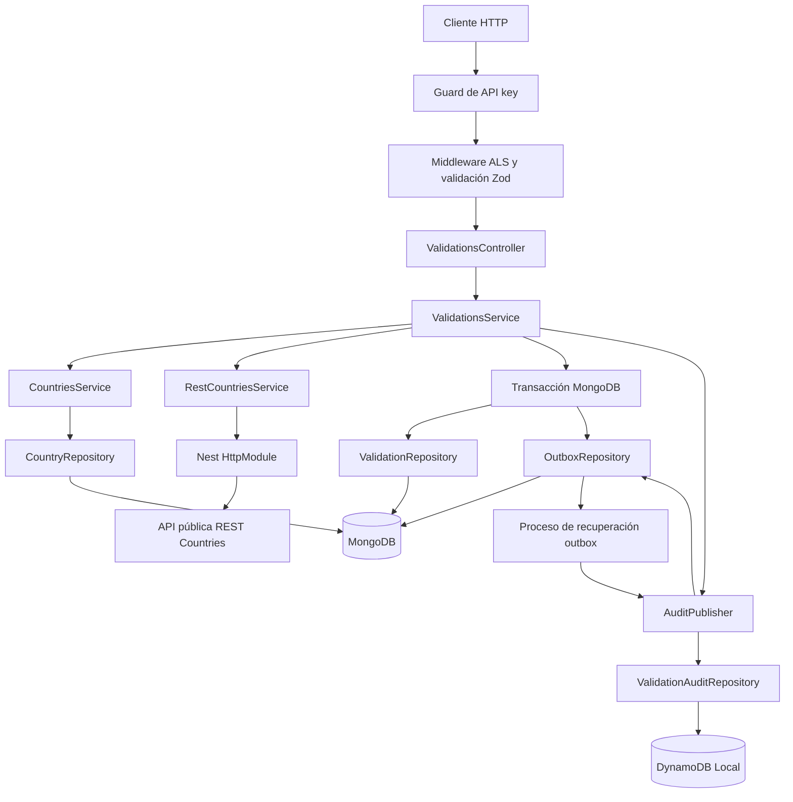

# 02  Arquitectura y decisiones técnicas

**Proyecto:** `external-validation-service-auco`  
**Estado:** Arquitectura propuesta; revisar con Opus antes de implementar  
**Referencias:** [`01-requirements.md`](./01-requirements.md), [`03-development-plan.md`](./03-development-plan.md)

## 1. Objetivos y principios

Entregar los dos endpoints exigidos por Auco y una auditoría robusta y demostrable. Priorizar mantenibilidad significativa sobre scaffolding empresarial. Separar con claridad los requisitos de la prueba de las mejoras propias: API key, país explícito, outbox, idempotencia y Swagger.

**Los ejemplos de código previamente compartidos por la persona desarrolladora son ideas de diseño, no código para copiar literalmente.**

**Regla innegociable:** no implementar verificación real de identidad; enriquecer datos geográficos nunca equivale a verificar una identidad.

## 2. Tecnologías y entorno local

| Área          | Decisión                                                  | Justificación                                     |
| ------------- | --------------------------------------------------------- | ------------------------------------------------- |
| Runtime       | Node.js 24                                                | Runtime e imagen Docker elegidos.                 |
| Framework     | NestJS 12 con adaptador Express                           | DI, módulos, guards, interceptors y pruebas HTTP. |
| Lenguaje      | TypeScript 6, `strict: true`, ESM nativo                  | Tipado sólido y base moderna.                     |
| Validación    | Zod y Standard Schema de NestJS                           | Validación runtime para entradas y entorno.       |
| Pruebas       | Vitest, `@nestjs/testing`, Supertest                      | Unitarias, integración y e2e.                     |
| MongoDB       | Driver oficial `mongodb`, una base de datos y replica set | API nativa y outbox transaccional.                |
| DynamoDB      | `@aws-sdk/client-dynamodb`, `@aws-sdk/lib-dynamodb`       | SDK AWS v3 y Document Client.                     |
| HTTP externo  | `@nestjs/axios` / `HttpModule` de NestJS                  | Timeouts y tratamiento de fallos externos.        |
| Documentación | `@nestjs/swagger`                                         | OpenAPI y Swagger UI.                             |
| Contenedores  | Docker Compose: MongoDB replica set, DynamoDB Local       | Desarrollo/evaluación reproducibles.              |
| Calidad       | ESLint, Prettier y typecheck                              | Reglas verificables automáticamente.              |

**Puertos locales definidos:** MongoDB `127.0.0.1:27018` → `27017` del contenedor; DynamoDB Local `127.0.0.1:8001` → `8000`. Si NestJS corre dentro de Docker Compose, usar nombres de servicio accesibles y configurar correctamente el host anunciado por el replica set; `localhost` del contenedor no apunta al host Windows.

## 3. Arquitectura lógica



El GET consulta exclusivamente `ValidationRepository`; no llama REST Countries ni DynamoDB.

### 3.1 Responsabilidades

- **Validación de entrada:** esquemas Zod para body, params, headers y entorno; nunca afirmar autenticidad documental.
- **CountriesModule:** catálogo local de países permitidos, índice único, seed idempotente y validación del país solicitado.
- **EnrichmentModule:** integración HTTP REST Countries, validación Zod de respuesta y mapeo a una fotografía geográfica pequeña. No recibe nombre ni documento.
- **ValidationsModule:** orquesta casos de uso, mapeos y contratos HTTP.
- **AuditModule:** identidad estable del evento, escritura condicional DynamoDB, actualización de estado y recuperación de pendientes.
- **DatabaseModule:** clientes MongoDB y AWS, proveedores, conexión y ciclo de vida; infraestructura Mongo/Dynamo por separado.
- **CommonModule (`@Global`)**: único módulo global; contexto, HTTP compartido, excepciones, guard y herramientas comunes. Nunca globalizar los módulos de dominio.

## 4. Estructura de carpetas (crear solo las necesarias)

```text
src/
├── main.ts
├── app.module.ts
├── app.setup.ts
├── swagger-conf.ts
├── config/
│   ├── env.schema.ts
│   └── configuration.ts
├── common/
│   ├── common.module.ts
│   ├── decorators/
│   ├── filters/
│   ├── guards/
│   ├── interceptors/
│   ├── middlewares/
│   ├── services/
│   │   ├── http-request.service.ts
│   │   └── request-context.service.ts
│   ├── interfaces/
│   ├── constants/
│   └── utils/
├── database/
│   ├── database.module.ts
│   ├── mongo/
│   │   ├── mongo.module.ts
│   │   └── mongo.repository.ts
│   └── dynamo/
│       ├── dynamo.module.ts
│       └── dynamo.repository.ts
├── validations/
│   ├── validations.module.ts
│   ├── controllers/
│   ├── services/
│   ├── repositories/
│   ├── entities/
│   ├── interfaces/
│   ├── schemas/
│   ├── messages/
│   └── swagger/
├── countries/
│   ├── countries.module.ts
│   ├── services/
│   ├── repositories/
│   ├── entities/
│   ├── interfaces/
│   ├── schemas/
│   └── seeds/
├── enrichment/
│   ├── enrichment.module.ts
│   ├── services/
│   ├── interfaces/
│   └── schemas/
└── audit/
    ├── audit.module.ts
    ├── services/
    ├── repositories/
    └── interfaces/
```

Incorporar `OutboxRepository`, `AuditPublisher` y recuperación en las carpetas que correspondan. Builders y validadores de dominio solo cuando exista complejidad que lo justifique. No crear carpetas vacías por costumbre. `swagger/` contiene metadata/constantes, no modelos DTO duplicados.

## 5. Procesamiento de solicitudes y diseño HTTP

1. **Middleware:** generar UUID `requestId`, registrar `requestUrl` y `startedAt`, devolver `x-request-id` y crear contexto AsyncLocalStorage. `countryCode` empieza sin valor y se establece después de validar el header; reflejarlo en tipos (`string | undefined`) mientras no esté validado.
2. **Guard global:** exigir `x-api-key`, salvo rutas explícitamente `@Public()` como health. Comparar con secreto validado; nunca registrar la llave.
3. **Zod:** validar body, parámetros y país. `x-country-code` obligatorio en POST; pendiente decidir su uso en GET.
4. **Controller delgado:** delega al servicio. GET lee Mongo; POST enriquece, persiste y audita.
5. **`ResponseInterceptor`:** puede envolver respuestas **exitosas** y mapear `_id` a `id`, sin considerar `null`, `false`, `0` ni arrays vacíos como fallos automáticos. Contrato pequeño y probado.
6. **`TimeOutInterceptor`:** convierte `TimeoutError` RxJS a `GatewayTimeoutException`, propagando los demás errores. Configurar además timeouts por dependencia; un timeout RxJS no garantiza abortar operaciones Mongo/Dynamo.
7. **`AllExceptionFilter`:** solo maneja **errores**, conserva códigos relevantes y devuelve `{ statusCode, error, message, path, timestamp, requestId }` sin PII, stacks ni credenciales.

Ejemplo ilustrativo:

```ts
catchError((error: unknown) => {
  if (error instanceof TimeoutError) {
    return throwError(() => new GatewayTimeoutException('Request timeout'));
  }
  return throwError(() => error);
});
```

### 5.1 Rutas y respuestas

- `POST /validations`: `201` e `id` creado cuando se cumpla la política de confirmación de auditoría aprobada.
- `GET /validations/:id`: `200` y registro; `400` ID malformado, `404` inexistente.
- `GET /health`: `200` liveness mínimo, público, sin detalles internos.
- Swagger UI: `SWAGGER_ENABLED`; `addApiKey` + `@ApiSecurity('api-key')`; no imponer prefijos/versionado adicionales. Proteger o deshabilitar Swagger en producción.

### 5.2 Metadata y Swagger

- Constantes generales en `src/swagger-conf.ts` (título, descripción, versión y esquema de seguridad).
- Constantes específicas `SWCONF_VALIDATIONS` en `validations/swagger/`, usadas desde `@ApiOperation(...)`, decoradores de respuesta y `@ApiSecurity('api-key')` a nivel de controller.
- Aprovechar Zod/Standard Schema para generar OpenAPI cuando sea compatible con las versiones instaladas. No duplicar modelos enteros con decoradores salvo necesidad técnica.

## 6. Configuración e inyección de dependencias

- `env.schema.ts`: helpers `requiredString`, enteros positivos con default, booleanos estrictos (`'true' | 'false'`) y `validateEnv` con errores legibles sin revelar secretos.
- `configuration.ts`: configuración central tipada, integrada con `ConfigModule.forRoot({ isGlobal: true, validate: validateEnv })` o fábrica tipada equivalente soportada. No depender de efectos laterales de importación.
- Configurar puerto/entorno, Swagger, URI/DB Mongo, endpoint/tabla/región/credenciales locales Dynamo, API key, URL REST Countries, timeouts y, si aplica, intervalo/backoff de outbox.
- `.env` jamás se commitea. `.env.example` contiene placeholders y credenciales ficticias AWS Local. Nunca loguear el objeto de configuración completo.
- `main.ts` solo inicializa; `configureApp(app)` en `app.setup.ts` reutilizado tanto en ejecución como en tests e2e.

## 7. Diseño MongoDB

### 7.1 Colecciones

**`countries`**

```ts
interface ICountry {
  code: string; // ISO alfa-2 en mayúsculas
  name: string;
  enabled: boolean;
  createdAt: Date;
  updatedAt: Date;
}
```

Índice único `{ code: 1 }`; seed `CO`, `MX` con `$setOnInsert` y `upsert: true`, sin sobrescribir datos anteriores. No inferir países de operación de Auco sin confirmación.

**`validations`** (campos ilustrativos, cerrar esquema con Opus):

```ts
interface IValidation {
  name: string;
  documentNumber: string;
  countryCode: string;
  enrichment: ICountryEnrichment;
  createdAt: Date;
  idempotencyKey?: string;
  requestFingerprint?: string;
}
```

`_id` de MongoDB es interno; la API expone `id`. Decidir si los metadatos de idempotencia viven en la validación o en un registro separado, según minimización de datos. Debe existir un índice único para el alcance de idempotencia elegido.

**`audit_outbox`**

```ts
interface IAuditOutboxEvent {
  eventId: string;
  validationId: string;
  documentNumber: string; // proteger en logs
  eventType: 'VALIDATION_CREATED';
  occurredAt: Date;
  status: 'PENDING' | 'PUBLISHED';
  attempts: number;
  nextAttemptAt?: Date;
  publishedAt?: Date;
}
```

Reintentos más avanzados pueden necesitar lease/lock y política de fallos terminales; implementar solo lo utilizado. Índice único `eventId` y otro eficiente para buscar eventos pendientes según próximo intento.

### 7.2 Repositorio MongoDB mínimo

`abstract class MongoRepository<T extends object>` tendrá `MongoClient`, nombres de base/colección, `Collection<T>` tipada y solo operaciones compartidas necesarias (`create`, `findById`, `findOne` y soporte transaccional, según uso real). Los repositorios concretos implementan búsquedas/actualizaciones de dominio. Soportar `ClientSession` donde intervenga una transacción. Conservar errores por índice único hasta mapearlos correctamente en la capa de aplicación.

**Prohibido en el repositorio base:** `process.exit()`, `setTimeout()`, soft delete, paginación, métodos innecesarios y conversión indiscriminada de excepciones a `500`.

### 7.3 Límite transaccional

Iniciar una sesión MongoDB; insertar validación y evento pendiente en **una sola transacción**. Si falla cualquiera de las operaciones, hacer rollback de ambas. Crear índices y semillas fuera de la transacción del caso de uso. Manejar fallos transitorios sin repetir ciegamente operaciones no idempotentes.

## 8. Enriquecimiento REST Countries

- API pública; país elegido explícitamente por header, no derivado del documento.
- Validar primero `countries`; solo transmitir el `code` a REST Countries.
- Aislar `RestCountriesService` del controller. `HttpRequestService` puede manejar solicitudes compartidas, estado, duración y timeout; el servicio específico conoce el contrato REST Countries.
- Validar con Zod; transformar únicamente campos útiles, aceptar opcionales ausentes y no guardar todo el payload remoto. Registrar `source: 'rest-countries'` y `enrichedAt` cuando aporte trazabilidad.
- Distinguir timeout, respuesta HTTP no 2xx, país no encontrado, datos malformados y errores internos.
- No hacer verificación de identidad ni inferir nacionalidad. Jamás enviar identificadores personales a REST Countries.

## 9. DynamoDB y auditoría

### 9.1 Clientes y jerarquía

```text
DynamoDBClient
  └── DynamoDBDocumentClient
       └── DynamoRepository<T>
            └── ValidationAuditRepository
```

La clase base maneja cliente, tabla y comandos compartidos estrictamente necesarios. `ValidationAuditRepository` construye `PK`/`SK`, payload y escritura condicional. **Nunca** fusionar las clases base MongoDB y DynamoDB.

### 9.2 Llaves y evento

```text
PK = DOCUMENT#<documentNumber>
SK = <ISO_UTC_TIMESTAMP>#<stableEventId>
```

Atributos adicionales: `eventId`, `validationId`, `eventType`, `createdAt` y opcionalmente `countryCode` y metadata mínima. La partición agrupa eventos del documento y la sort key los ordena cronológicamente. Generar fecha e ID **una sola vez** y reutilizarlos en todos los reintentos.

Usar `ConditionExpression` de `PutItem` para prevenir colisiones en la llave completa (por ejemplo `attribute_not_exists(PK)`). Si ocurre falla condicional, comprobar `eventId`/identidad del registro existente antes de considerarlo replay exitoso; no ocultar conflictos verdaderos.

**Privacidad:** números de documento en llaves pueden ser sensibles. Aunque la prueba exige llaves por documento/fecha, en producción evaluar llave derivada con HMAC y autorización adecuada.

## 10. Consistencia, recuperación e idempotencia

### 10.1 Secuencia de fallo

```text
POST /validations
  -> Transacción MongoDB: validación + evento PENDING, commit atómico
  -> Intento de escritura condicional en DynamoDB
       -> éxito: marcar outbox PUBLISHED y responder según política
       -> fallo: conservar outbox pendiente y permitir recuperación
```

Un proceso periódico o de recuperación al iniciar **debe** procesar eventos pendientes cuando DynamoDB vuelva. Puede bastar un scheduler local sencillo, pero hay que evitar que múltiples publicadores regeneren identidades o alteren estados indebidamente. Si DynamoDB guarda correctamente y luego falla actualizar `PUBLISHED`, el replay debe reconocer el mismo evento y completar la conciliación.

### 10.2 Política provisional de confirmación HTTP

**Recomendación pendiente de aprobación explícita:** `201 Created` únicamente cuando DynamoDB confirma el evento; si falla, `503 Service Unavailable`, aunque la validación y el outbox pueden estar persistidos. Es una lectura conservadora de «cada creación debe escribir un evento», **no** una exigencia textual de Auco.

- `503` **no garantiza** que nada haya sido persistido.
- Reintentar con el mismo `Idempotency-Key` debe reutilizar validación y evento existentes.
- Definir la respuesta exacta si el publicador recuperó el evento antes de que el cliente reintente; documentar y probar.
- Alternativas a revisar: `201` tras commit duradero de outbox con auditoría eventual, o `202` de operación aceptada. Seleccionar **una** política; nunca afirmar atomicidad entre ambas bases.

### 10.3 Idempotencia y concurrencia

- `Idempotency-Key` lo suministra el cliente, con alcance documentado para esta prueba y fingerprint del body normalizado más país.
- Índice único: misma clave + misma operación → reutilizar resultado; misma clave + payload diferente → `409 Conflict`. Controlar solicitudes concurrentes.
- `requestId` solo correlaciona logs, cambia por solicitud y **no** reemplaza la clave de negocio.
- Para auditoría, usar `eventId` estable y `ConditionExpression` en DynamoDB, independientes de la idempotencia HTTP.
- Recuperación y reintentos reutilizan **el mismo** ID de evento; no depender exclusivamente de la solicitud inicial.

## 11. Verificación de identidad: extensión futura únicamente

**No implementar verificación real ahora**, por tres razones:

1. El contrato original incluye nombre y número, pero carece de país de emisión y tipo documental. Incluso si existe `x-country-code` para enriquecimiento, este **no demuestra** nacionalidad ni titularidad.
2. Fuentes confiables necesitan procedencia, cobertura y condiciones verificables de tratamiento de datos personales.
3. Integrar proveedores reales de identidad amplía el alcance más allá de los requisitos evaluados.

En el futuro se podrá incorporar `IdentityVerificationService` independiente de `EnrichmentService`, con estados **solo documentados, no implementados**:

- `NOT_VERIFIED`: no se realizó verificación real.
- `VERIFIED`: proveedor confiable confirmó identidad.
- `REJECTED`: proveedor detectó una discrepancia.
- `UNAVAILABLE`: verificación no pudo completarse.

Jamás devolver `VERIFIED` por haber superado Zod o consultado REST Countries.

## 12. Riesgos y mitigaciones

| Riesgo                                                        | Mitigación / prueba                                                                                |
| ------------------------------------------------------------- | -------------------------------------------------------------------------------------------------- |
| MongoDB standalone no permite transacciones                   | Replica set `rs0`; prueba real de commit y rollback.                                               |
| Host del replica set no accesible desde Windows o Docker      | Probar URI desde runtime real y documentar resolución de host.                                     |
| Error de permisos SQLite en volumen DynamoDB                  | Verificar volumen persistente escribible y funcionamiento tras reinicio; evitar root si es viable. |
| REST Countries indisponible o esquema modificado              | Timeout, Zod, errores `502`/`504` y pruebas contractuales con mocks.                               |
| Mongo guarda y Dynamo falla                                   | Outbox, identidades estables, reintentos y política HTTP documentada.                              |
| Cliente reintenta POST tras `503`                             | `Idempotency-Key` único y fingerprint con conflicto explícito.                                     |
| Dynamo escribe pero falla respuesta o actualización de estado | Escritura condicional idempotente y conciliación `PUBLISHED`.                                      |
| Uso excesivo de `@Global`                                     | Solo `CommonModule`; dependencias de dominio explícitas.                                           |
| PII o API key en logs                                         | Redacción/minimización y tests; nunca registrar bodies completos.                                  |
| Excesiva complejidad para la prueba                           | Etapas pequeñas; aplazar funcionalidades no exigidas.                                              |
| Swagger muestra auth, pero el guard no protege                | Tests e2e de seguridad y verificación OpenAPI.                                                     |

## 13. Registro de decisiones arquitectónicas

| ID   | Decisión                                                       | Estado                                    |
| ---- | -------------------------------------------------------------- | ----------------------------------------- |
| D-01 | NestJS 12, TS estricto, ESM, Zod y Vitest                      | Aprobada                                  |
| D-02 | MongoDB nativo y repositorio genérico mínimo                   | Aprobada                                  |
| D-03 | SDK DynamoDB v3 oficial y repositorio genérico separado        | Aprobada                                  |
| D-04 | REST Countries, `x-country-code` y catálogo/seed `countries`   | Aprobada en POST; header en GET pendiente |
| D-05 | API key en validaciones, health público, Swagger security      | Aprobada                                  |
| D-06 | ConfigModule + Zod, `app.setup.ts`, solo `CommonModule` global | Aprobada                                  |
| D-07 | Contexto ALS, interceptors timeout/respuesta y filtro global   | Aprobada                                  |
| D-08 | Validación + outbox en transacción MongoDB, recuperación       | Concepto aprobado; ejecución pendiente    |
| D-09 | Partición Dynamo por documento; orden por fecha + ID estable   | Aprobada                                  |
| D-10 | Fallo Dynamo: `201` solo si confirma, en otro caso `503`       | **Provisional; revisar con Opus/Auco**    |
| D-11 | `Idempotency-Key` obligatorio u opcional en POST               | **Pendiente**                             |
| D-12 | Sin identidad real; capacidad futura documentada               | Aprobada                                  |
| D-13 | Claude nunca realiza commits ni push                           | Aprobada                                  |

## 14. Responsabilidades de cada componente

| Componente	             | Responsabilidad
| ------------------------ | ---------------------------------------------------------- |
| RequestContextMiddleware | Inicializar el contexto para cada solicitud HTTP           |
| RequestContextService	   | Proporcionar acceso al contexto mediante AsyncLocalStorage |
| IRequestContext	         | Definir las propiedades del contexto                       |
| @CurrentContext()	       | Permitir acceder al contexto desde los controllers         |

## 15. Criterios para aprobar la revisión arquitectónica

- Todos los requisitos de Auco se relacionan con tareas y pruebas concretas.
- Ningún header adicional se presenta como requisito original de Auco.
- Semántica de confirmación, reintentos y fallas parciales explícita y comprobable.
- Recuperación outbox tiene mecanismo concreto, limitado y duradero.
- DI, configuración, ESM e inicialización de bases pueden reproducirse.
- Opus distingue riesgos críticos de recomendaciones opcionales; la persona desarrolladora aprueba cambios antes de implementarlos.
